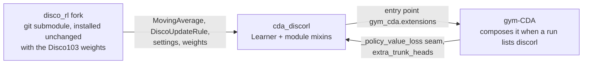

# cda-discorl

Learning mechanisms from *Discovering state-of-the-art reinforcement learning algorithms*
(Oh et al., 2025) for the PPO learner in
[gym-continuousDoubleAuction](https://github.com/ChuaCheowHuan/gym-continuousDoubleAuction)
(gym-CDA), packaged as a training extension. It depends on DeepMind's
[`disco_rl`](https://github.com/google-deepmind/disco_rl), through the
[ChuaCheowHuan/disco_rl](https://github.com/ChuaCheowHuan/disco_rl) fork, and imports whatever
`disco_rl` provides instead of reimplementing it: the Disco103 rule and its weights, the debiased
moving average, the published settings and costs. What stays local is what has to be PyTorch,
because gradients flow through it inside RLlib's Learner: the loss terms, the extra heads and
the update of a torch target network. The fork is the git submodule `third_party/disco_rl`,
pinned to a commit and installed unchanged with this package; none of its code or weights are
copied into this repository, and the fork itself is not edited
([docs/architecture.md](docs/architecture.md) §5 lists what comes from where).

Installing it changes no run. A run uses it only when its train config lists it:

```json
"extensions_enabled": ["discorl"],
"extension_settings": {"discorl": {"modules": ["policy_0"], "target_policy": true}}
```

To remove it, drop the name from `extensions_enabled` and uninstall the package. gym-CDA needs no
other edit. Its extension contract is gym-CDA's `docs/30_extensions.md`.

## Install

gym-CDA is not on PyPI, so install it first, then this package:

```bash
pip install "gym_continuousDoubleAuction @ git+https://github.com/ChuaCheowHuan/gym-continuousDoubleAuction"
pip install "cda-discorl @ git+https://github.com/ChuaCheowHuan/cda_disco_rl"
```

pip fetches the submodule, so the second line also installs `disco_rl` (as a top-level package,
with the Disco103 weights), JAX, Haiku and rlax. From a clone, fetch it yourself:

```bash
git clone --recurse-submodules https://github.com/ChuaCheowHuan/cda_disco_rl
pip install -e cda_disco_rl   # or: git submodule update --init, in an existing clone
```

JAX runs on the CPU here, beside PyTorch; it needs no GPU.

## How it fits



gym-CDA's
[docs/30_extensions.md](https://github.com/ChuaCheowHuan/gym-continuousDoubleAuction/blob/master/docs/30_extensions.md)
draws all three extension packages and their forks.

## Components

| Component | Switch | What it does | Status |
|---|---|---|---|
| Target policy | `target_policy` | KL from the policy to an EMA copy of itself | Recommended; ahead of PPO on average, not significantly |
| Advantage EMA | `adv_ema` | Normalises advantages by a lifetime EMA of their scale | Recommended |
| Value normalisation | `value_norm` | Critic learns returns on a unit scale | Best critic in testing; return within noise of PPO |
| Policy prediction | `policy_prediction` | Auxiliary head predicting the next step's policy | Experimental |
| Disco103 | `disco103` | The frozen discovered rule replaces PPO's loss on the discrete actions | Experimental; did not beat PPO at about 260k steps |

Every component is off by default. `modules` picks which trainable modules get them; the others
stay plain PPO, so one league run compares the two. [docs/components.md](docs/components.md)
describes each component and its metrics, [docs/configuration.md](docs/configuration.md) every
setting and its rules, and [docs/findings.md](docs/findings.md) how they compared against PPO and
why DiscoRL's categorical critic is not here.

A resume must enable the same extension with the same settings as the checkpoint. gym-CDA refuses
anything else, and refuses to restore a checkpoint that used `discorl` where this package is not
installed.

## Documentation

[docs/](docs/README.md) covers the architecture, the components, every setting, the comparison
against PPO and development (tests, CI, releasing). The [changelog](CHANGELOG.md) lists what
changed in each version.

## Licence

Apache-2.0, the licence of `disco_rl`; see `LICENSE` and `NOTICE`.
